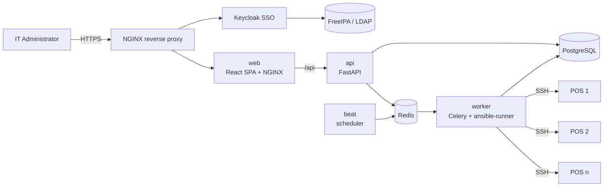
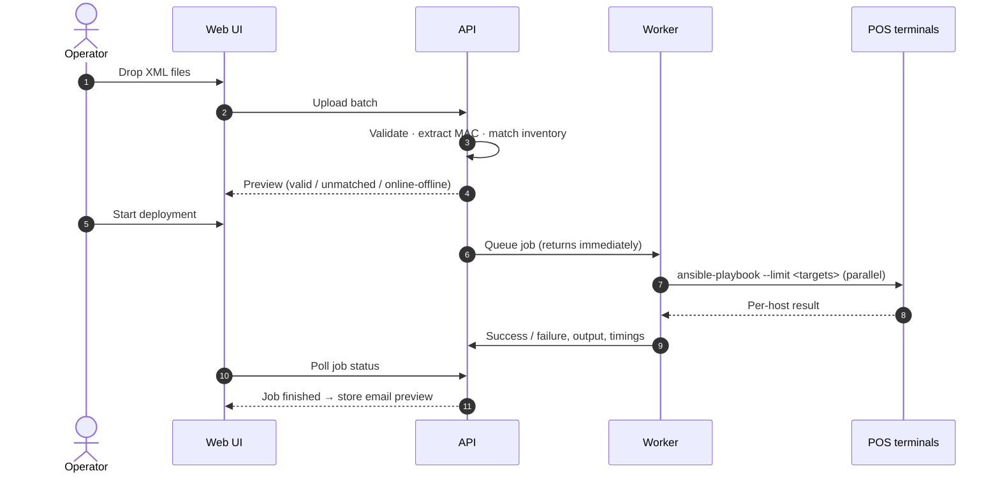

<div align="center">

# POS Enterprise Control Center

**Centralized POS configuration management — multi-file XML deployment, MAC-based matching, parallel Ansible orchestration and automated store notifications.**


</div>

---

## Table of contents

- [Overview](#overview)
- [Key features](#key-features)
- [Architecture](#architecture)
- [Deployment workflow](#deployment-workflow)
- [Tech stack](#tech-stack)
- [Project structure](#project-structure)
- [Getting started](#getting-started)
- [Configuration](#configuration)
- [Ansible integration](#ansible-integration)
- [Single sign-on](#single-sign-on)
- [Roles & permissions](#roles--permissions)
- [Security](#security)
- [Operations](#operations)
- [Project evolution](#project-evolution)
- [Roadmap](#roadmap)
- [Author](#author)

---

## Overview

Updating payment configuration on retail POS terminals traditionally means connecting to each terminal, replacing an XML file by hand, fixing ownership and permissions, and informing the store — one terminal at a time.

**POS Enterprise Control Center** turns that into a controlled, auditable workflow:

1. Upload any number of `MarshalPOS-<MAC>.XML` files in one operation.
2. Each file is validated and matched to its POS terminal by **MAC address**.
3. A single **Ansible** run deploys all files to all targets **in parallel**.
4. Per-POS results are tracked live and stored in a full deployment history.
5. A **branded email** is prepared for each affected store, ready to review and send from Outlook.

The web application is a management layer around Ansible — the browser never talks to a POS, and credentials never leave the server.

---

## Key features

| Area | Capability |
|---|---|
| **POS management** | Inventory with search, filters, sorting, paging, CSV import/export, bulk actions, scheduled reachability checks |
| **Store management** | Stores with brand, code, primary email and extra recipients; every POS inherits its store's notification address |
| **Multi-file upload** | Drag & drop many XML files at once, with per-file validation |
| **Intelligent matching** | Target resolved by hostname in file name → **MAC address in file name** → hostname inside the XML |
| **Validation** | Safe-filename whitelist, size limits, `defusedxml` parsing (XXE / entity attacks blocked), one file per POS, busy-POS protection |
| **Live POS status** | On-demand online/offline check of every target before deployment |
| **Parallel deployment** | One Celery job → one `ansible-runner` execution with forks, real-time per-POS progress |
| **Results & history** | Per-POS status, attempt count, execution time, full Ansible output and errors; retry failed POS or cancel running jobs |
| **Store notifications** | One email per store per job, listing successfully updated terminals; branded `.eml` draft (logo embedded) or plain-text `mailto:` fallback — never sent automatically |
| **Security** | Keycloak SSO (FreeIPA), RBAC, CSRF protection, rate-limited login, append-only audit log |
| **UX** | Enterprise dashboard, collapsible icon sidebar, light/dark theme, responsive layout |

---

## Architecture



- **api** — authentication, RBAC, validation, matching, store/email logic, audit.
- **worker** — the only component that runs Ansible and reaches POS networks.
- **beat** — periodic POS health checks and artifact cleanup.
- Database and Redis sit on an internal Docker network and are never exposed.

---

## Deployment workflow



On each POS the playbook: verifies the target directory → backs up the current file → pushes the new `MarshalPOS.XML` with the required owner, group and mode → optionally reboots the terminal.

---

## Tech stack

| Layer | Technologies |
|---|---|
| Frontend | React 18, TypeScript, Mantine 7, TanStack Query, Vite |
| Backend | Python 3.12, FastAPI, SQLAlchemy 2, Pydantic 2, Alembic |
| Jobs | Celery 5, Redis 7 |
| Automation | ansible-core 2.16 (supports Python 2.7 managed nodes), ansible-runner |
| Database | PostgreSQL 16 |
| Identity | Keycloak (OIDC, Authorization Code + PKCE), FreeIPA |
| Delivery | Docker Compose, NGINX |

---

## Project structure

```
pos-enterprise-control-center/
├── docker-compose.yml          # production stack
├── docker-compose.dev.yml      # development overrides
├── .env.example                # all configuration (copy to .env)
├── Makefile                    # init / build / up / logs / save / load
├── scripts/init-secrets.sh     # generates .env secrets and secret files
├── secrets/                    # Docker secrets (git-ignored, worker only)
├── docs/                       # architecture notes, sample CSV
├── backend/
│   ├── alembic/versions/       # database migrations
│   ├── ansible/                # playbook, ansible.cfg, group_vars
│   └── app/
│       ├── api/v1/             # auth, sso, users, pos, stores, deployments, email, audit
│       ├── core/               # config, security, RBAC, rate limiting
│       ├── models/ schemas/    # SQLAlchemy models, Pydantic schemas
│       ├── services/           # ansible, deployment, xml, pos, audit, health
│       └── worker/             # Celery app and tasks
└── frontend/src/
    ├── api/ auth/              # API client (CSRF), hooks, auth context
    ├── components/             # layout, sidebar, drawers, modals
    ├── features/               # deployment-email, stores
    └── pages/                  # dashboard, POS, deployments, stores, users, audit
```

---

## Getting started

### Prerequisites
- Docker 24+ with the Compose plugin
- Network reachability from the Docker host to the POS networks (SSH, port 22)

### Installation

```bash
git clone git@github.com:<your-username>/pos-enterprise-control-center.git
cd pos-enterprise-control-center

make init                              # creates .env with random secrets + empty secret files
nano .env                              # review settings (see Configuration)

echo -n '<ssh-password>'  > secrets/ansible_ssh_password
echo -n '<sudo-password>' > secrets/ansible_become_password
sudo chown 1000:1000 secrets/ansible_* && chmod 600 secrets/ansible_*

make build && make up
make logs
```

Open `http://<host>:8080` and sign in with the initial admin printed by `make init`. Database migrations run automatically when the API starts.

### Offline servers

```bash
make save          # on a connected machine → poscc-images-<tag>.tar.gz
make load && make up   # on the target server
```

---

## Configuration

All settings live in `.env` (template: `.env.example`).

| Variable | Purpose |
|---|---|
| `SECRET_KEY` | Session signing key (generated by `make init`) |
| `COOKIE_SECURE` | `true` behind HTTPS |
| `ALLOWED_HOSTS` | Accepted host names |
| `ANSIBLE_PLAYBOOK` | Playbook to run (default `site.yml`) |
| `ANSIBLE_AUTH_MODE` | `password` or `key` |
| `ANSIBLE_FORKS` | Maximum parallel hosts per run |
| `ANSIBLE_EXTRA_VARS` | Extra variables, e.g. `{"pos_reboot": false}` |
| `ANSIBLE_VAR_MAP` | Map platform variables to existing playbook variable names |
| `HEALTH_CHECK_*` | Scheduled reachability check settings |
| `OIDC_*` | Keycloak SSO settings |
| `LOCAL_LOGIN_ENABLED` | Keep a local break-glass admin login |

---

## Ansible integration

The worker mounts `backend/ansible/` read-only and runs the playbook with **ansible-runner** (Python API — no shell commands built from user input).

For every target the generated inventory provides:

| Variable | Example |
|---|---|
| `pos_hostname`, `inventory_hostname` | `POS-001` |
| `ansible_host`, `pos_ip` | `192.0.2.10` |
| `xml_src_path` | path of the validated upload on the worker |
| `xml_filename` | `MarshalPOS-AABBCC112201.XML` |
| `poscc_job_id` | job reference used for backup suffixes |

Credentials are read from Docker secrets at run time and are never written to the database or sent to the browser.

---

## Single sign-on

Users authenticate with their FreeIPA account through Keycloak. The application role is derived from FreeIPA group membership on every sign-in:

| FreeIPA group | Role |
|---|---|
| `pos-admins` | Admin |
| `pos-operators` | Operator |
| `pos-viewers` | Viewer |

Users without a mapped group are refused.

---

## Roles & permissions

| Permission | Admin | Operator | Viewer |
|---|:-:|:-:|:-:|
| View POS, jobs, dashboard | ✓ | ✓ | ✓ |
| Add / edit POS, import CSV | ✓ | ✓ | |
| Upload XML, run / retry / cancel deployments | ✓ | ✓ | |
| Delete POS | ✓ | | |
| Manage users and stores | ✓ | | |
| View audit logs and system settings | ✓ | | |

All checks are enforced server-side.

---

## Security

- Argon2id password hashing; httpOnly, SameSite=Strict session cookies
- CSRF double-submit token bound to the session
- Login rate limiting and account lockout
- XML parsed with `defusedxml`; strict file-name whitelist and path-traversal protection
- No shell execution from HTTP requests; Ansible runs only in the worker
- Secrets in `.env` / Docker secrets only — excluded from Git
- Append-only audit log enforced by a database trigger
- Database and Redis isolated on an internal Docker network

---

## Operations

| Task | Command |
|---|---|
| Status | `make ps` |
| Logs | `make logs` |
| Scale workers | `docker compose up -d --scale worker=3` |
| Database backup | `docker compose exec -T postgres pg_dump -U poscc -Fc poscc > backup.dump` |
| Upgrade | `git pull && make build && make up` |

---

## Project evolution

This release is a major evolution of an earlier single-file deployment tool.

| Capability | Previous version | Enterprise Control Center |
|---|---|---|
| User interface | Basic | Redesigned enterprise UI |
| File upload | One XML at a time | Multiple files in one operation |
| POS matching | Limited | Automatic MAC-address matching |
| Validation | Basic | Comprehensive pre-deployment validation |
| Deployment | Single file | Multiple files to multiple POS in parallel |
| Tracking | Basic status | Live per-POS progress and full output |
| Notifications | Not available | Branded per-store email drafts |
| Reporting | Limited | Centralized history and per-POS results |

---

## Roadmap

- HTTPS end-to-end with verified internal CA
- Scheduled deployments (outside store hours)
- Deployment approval workflow
- Configuration drift detection

---

## Author

**Ashraf Elgohary** — Systems Support Engineer
Linux · Ansible · Python · Docker · Enterprise IT Operations

> Internal project. All examples in this repository use fictional host names, MAC and IP addresses.
