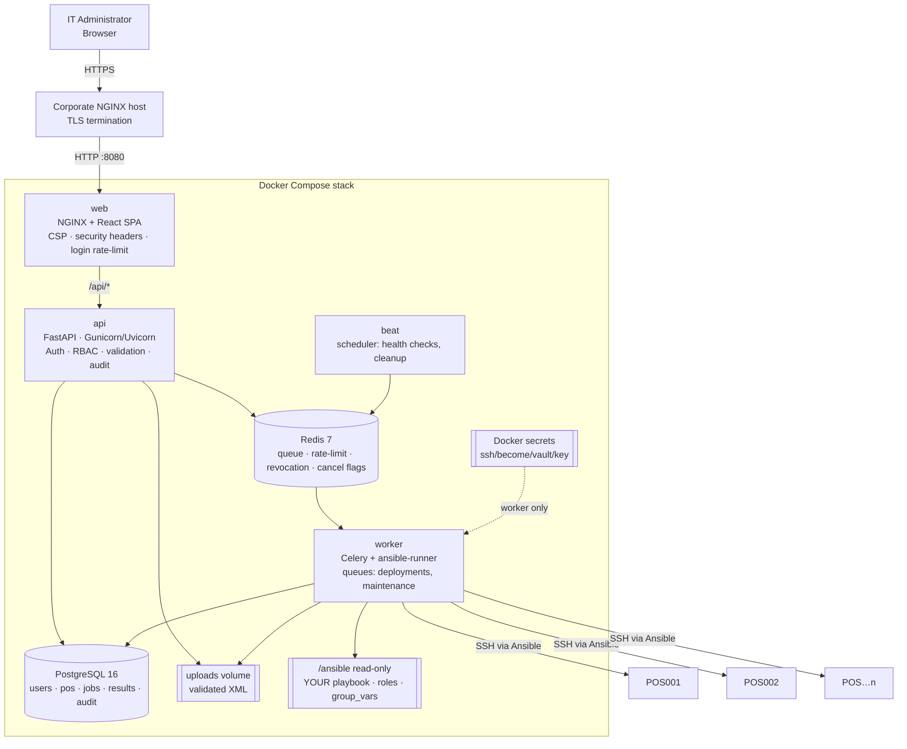
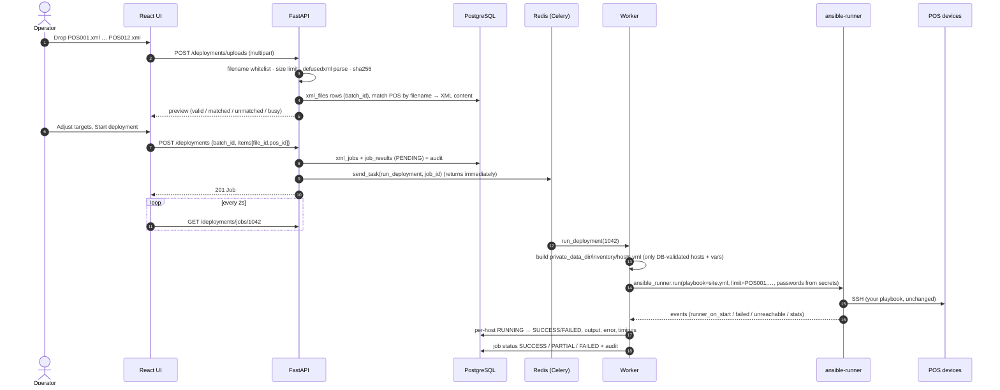
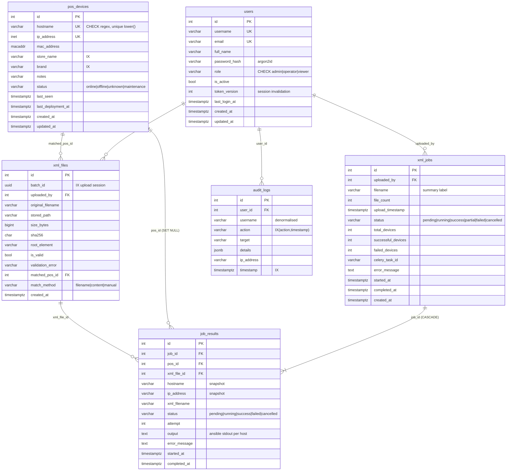

# POS Control Center — Architecture

## 1. System architecture

**Network segmentation:** `backend` is an `internal: true` network (Postgres, Redis, API, worker). Only `web` publishes a port. Only `worker` joins the `egress` network that routes to the store POS VLANs. **The browser never talks to a POS, and Ansible credentials exist only inside the worker container.**

## 2. How the GUI talks to Ansible

### Why this is safe
| Risk | Control |
|---|---|
| Command injection | No shell. `ansible-runner` Python API spawns `ansible-playbook` with an argv list. Variables are written as JSON data to the inventory / extravars, never concatenated into a command. Playbook path is config-only and verified to live inside `/ansible`. |
| Arbitrary hosts | Inventory is generated from the database only. Hostnames are regex-validated at API **and** DB (`CHECK` constraint); IPs are parsed by `ipaddress` and stored as `INET`. |
| Path traversal | Filenames must match `^[A-Za-z0-9][A-Za-z0-9._-]{0,120}\.xml$`; storage path is `uploads/<uuid>/<name>` and resolved/verified to stay inside the upload root; files opened with `O_EXCL`. |
| Malicious XML | `defusedxml` with DTDs, entities and external references forbidden (XXE / billion-laughs). |
| Credential exposure | SSH / become / vault passwords are Docker secrets mounted only in `worker`, fed to Ansible's prompts via ansible-runner `passwords` (not in the DB, never sent to the browser). |
| Long runs blocking HTTP | Celery queue; API returns immediately; `acks_late` + `reject_on_worker_lost` re-queue if a worker dies. |
| Concurrent deploys to the same POS | API rejects (HTTP 409) any job that targets a POS with a pending/running result. |

## 3. Database ERD

Notes: `audit_logs` is **append-only**, enforced by a PostgreSQL trigger (UPDATE/DELETE raise). `job_results` keeps a hostname/IP snapshot so history survives POS edits or deletion. Users are deactivated, never hard-deleted.

## 4. API (prefix `/api/v1`)

All endpoints except `/auth/login` and `/health*` require the session cookie. Every POST/PUT/PATCH/DELETE also requires the `X-CSRF-Token` header.

| Method | Path | Permission | Purpose |
|---|---|---|---|
| POST | `/auth/login` | public (rate-limited) | Username/email + password → httpOnly session cookie + CSRF cookie |
| POST | `/auth/logout` | any | Revoke session (JTI denylist) |
| GET | `/auth/me` | any | Current user + permissions |
| POST | `/auth/change-password` | any | Rotates `token_version` (signs out other sessions) |
| GET | `/roles` | pos:read | Role → permission matrix |
| GET/POST | `/users` | users:manage | List / create |
| PATCH | `/users/{id}` | users:manage | Edit role/email/name, activate/deactivate |
| POST | `/users/{id}/reset-password` | users:manage | Admin password reset |
| GET | `/pos` | pos:read | Search `q`, filter `status/store/brand`, `sort/order`, `page/page_size` |
| POST | `/pos` | pos:write | Create |
| GET/PATCH/DELETE | `/pos/{id}` | read / write / delete | Detail, edit, delete |
| POST | `/pos/bulk-delete` | pos:delete | `{ids:[…]}` |
| POST | `/pos/import` | pos:import | CSV upload, `update_existing` |
| GET | `/pos/export` | pos:import | CSV (formula-injection safe) |
| GET | `/pos/facets` · `/pos/lookup` | pos:read | Filter values · typeahead |
| GET | `/pos/{id}/deployments` | jobs:read | Per-POS deployment history incl. output |
| POST | `/deployments/uploads` | xml:upload | Multi-file XML upload → validated preview batch |
| DELETE | `/deployments/uploads/{batch_id}` | xml:upload | Discard an unused batch |
| POST | `/deployments` | jobs:run | Create job `{batch_id, items:[{file_id,pos_id}]}` → queued |
| GET | `/deployments/jobs` | jobs:read | `view=all|running|failed`, `q`, paging |
| GET | `/deployments/jobs/{id}` | jobs:read | Job + per-POS results |
| GET | `/deployments/results/{id}` | jobs:read | Full Ansible output / error |
| POST | `/deployments/jobs/{id}/retry` | jobs:run | Retry all failed/cancelled POS |
| POST | `/deployments/results/{id}/retry` | jobs:run | Retry one POS |
| POST | `/deployments/jobs/{id}/cancel` | jobs:run | Cancel pending + stop running Ansible |
| GET | `/audit-logs` · `/audit-logs/actions` · `/audit-logs/export` | audit:read | Search/filter/export |
| GET | `/dashboard/summary` | pos:read | Cards, 14-day trend, store health, activity |
| GET | `/system/info` | system:read | Non-secret config, worker status |
| GET | `/health` · `/health/ready` | public | Liveness / readiness |

## 5. RBAC

| Permission | Admin | Operator | Viewer |
|---|:-:|:-:|:-:|
| Manage users | ✓ | | |
| View POS | ✓ | ✓ | ✓ |
| Add / edit POS | ✓ | ✓ | |
| Delete POS | ✓ | | |
| Import / export POS | ✓ | ✓ | |
| Upload XML | ✓ | ✓ | |
| Run / retry / cancel jobs | ✓ | ✓ | |
| View job history | ✓ | ✓ | ✓ |
| View audit logs | ✓ | | |
| View system settings | ✓ | | |

Roles live in `backend/app/core/rbac.py`, so changes go through code review. Enforcement is server-side on every endpoint; the UI only hides controls a user cannot use.

## 6. Authentication design
- **Argon2id** password hashing (auto-rehash on login when parameters change), constant-time path for unknown users.
- **JWT in an httpOnly, SameSite=Strict, Secure cookie** — not readable by JavaScript, so XSS cannot steal it.
- **CSRF:** double-submit token whose HMAC is embedded in the JWT, so a forged cookie is useless.
- **Sliding sessions** (re-issued after half-life). Logout writes the JTI to a Redis denylist. `token_version` invalidates all sessions on password change, deactivation or role change.
- **Brute-force protection:** NGINX `limit_req` on `/auth/login`, Redis per-IP limit, and per-account lockout after N failures.
